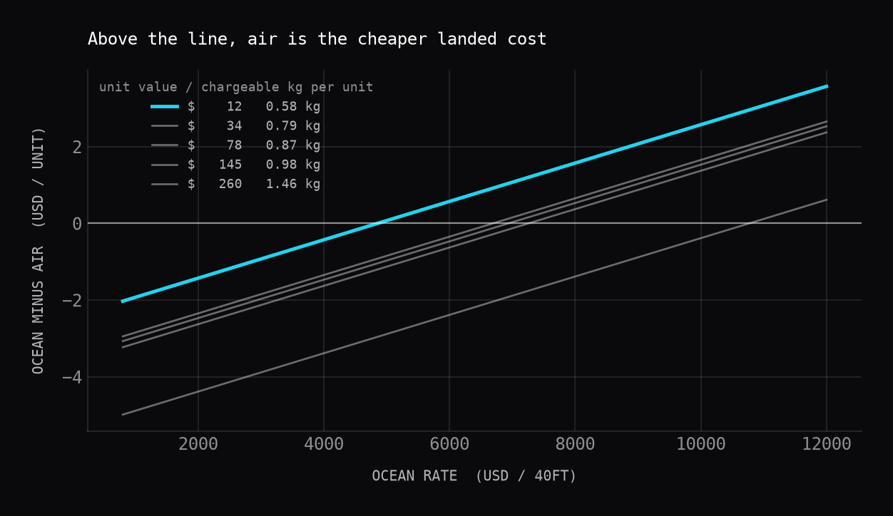

# Freight Mode & Landed Cost Optimizer

Decides **air or ocean** for a book of international shipments by minimising
total landed cost subject to a finite air allocation and a service-level
target. Mixed-integer program, solved with CBC.

Built around a claim that sounds obvious and mostly isn't: *comparing freight
rates does not tell you which mode is cheaper.* Fixed per-shipment charges and
the capital cost of transit time both move the answer, and on close calls they
decide it.

---

## Headline findings

Shanghai → Los Angeles, 60 shipments, 289,632 units, rates as of **June 2026**.

**1. At today's rates, air never wins on cost — it is bought entirely for speed.**

Ocean sits at ~$2,405/FEU. The cheapest SKU in the book doesn't break even
until **$4,840/FEU**, and the most expensive not until **$10,773**. Ocean rates
did reach that range in 2021–22, so this is a real threshold rather than a
theoretical one, but it is nowhere near today.

**2. Air competitiveness tracks chargeable weight per unit, not unit value.**

This is the counterintuitive one. The **$12/unit** SKU breaks even first, at
$4,840/FEU; the **$260/unit** SKU breaks even last, at $10,773 — more than
twice as high.

| SKU | Unit value | Chargeable kg/unit | Break-even ocean rate |
|---|---|---|---|
| SKU-1001 | $12 | 0.58 | **$4,840** |
| SKU-1002 | $34 | 0.98 | $6,681 |
| SKU-1003 | $78 | 1.04 | $6,937 |
| SKU-1004 | $145 | 0.98 | $7,244 |
| SKU-1005 | $260 | 1.46 | $10,773 |

Air bills on chargeable weight, so what matters is how much billable weight
each saleable unit carries. The $260 SKU packs 2 units per carton and drags
1.46 kg of chargeable weight per unit; the $12 SKU packs 24 and carries 0.58.
Value density is the intuition; **weight per unit is the mechanism.**

**3. Hitting 95% on-time costs $387K more than ignoring due dates.**

| | Cost | Air used | Late |
|---|---|---|---|
| Cheapest mode per shipment | $1,876,946 | 367 kg | **21 of 60** |
| Optimised at 95% on-time | $2,264,134 | 85,029 kg | 3 of 60 |

The cheapest-mode baseline is what a spreadsheet produces. It is 17% cheaper
and misses a third of the due dates. The $387K gap is the price of the service
promise, and it is the number worth arguing about in a planning meeting.

Across the range, moving from a 70% to a 95% target costs **$294,694 (+16%)**,
and 95% is the ceiling — at 95,000 kg of weekly air allocation, no allocation
exists above it.



---

## What's real and what's assumed

Stated up front, because a landed-cost model is only as honest as its inputs.

**Real** — two published series from FRED (St. Louis Fed), free, no API key:

| Series | Description | Coverage |
|---|---|---|
| `PCU483111483111` | PPI, Deep Sea Freight Transportation | 1988-06 → 2026-06 |
| `PCU481112481112` | PPI, Scheduled Freight Air Transportation | 2003-12 → 2026-06 |

These give the *shape* of rate movement — when ocean spiked, how far, how air
moved with it.

**Assumed** — a PPI is an index, not a price, so it cannot say what a container
costs. Each mode is anchored to a stated market level for one reference month
(2024-01: **$2,200/FEU** ocean, **$5.00/chargeable kg** air) and indexed from
there. Both sit inside commonly reported ranges for the lane. Neither is a
quote, and they are the weakest input in the project — which is why
`report.py` sweeps both across a grid rather than asserting a point estimate.
Air wins in **31%** of that grid.

Also assumed: 25-day ocean and 3-day door-to-door air transit, 9.5% cost of
capital, 80% container cube utilisation, 4.3% duty. All are named constants,
not magic numbers buried in formulas.

**Synthetic** — the 60 shipment records. There is no public dataset of
company-level shipment data; the generator is seeded (`seed=42`) so every
number above reproduces exactly.

An earlier version of this analysis used BTS ocean spot rates directly. That
source now returns 403 to non-browser clients. FRED is the better source
anyway: it covers both modes rather than a single ocean lane.

---

## The model

```
minimise   Σᵢ Σₘ  cost[i][m] · x[i][m]   +   penalty · Σᵢ late[i]

s.t.       Σₘ x[i][m] = 1              ∀i    one mode per shipment
           Σᵢ x[i][air] · kg[i] ≤ air_capacity
           Σᵢ (1 − late[i]) ≥ ⌈service · N⌉
           late[i] ≥ x[i][m]           ∀ m that misses i's due date
           x, late ∈ {0,1}
```

Greedy fails here because the decisions are coupled: air capacity is shared, so
flying one shipment can push another off, and the service target applies to the
book rather than to each shipment. Both couplings are what make it a solver
problem instead of a sort.

### Landed cost components

Per unit, per mode — freight is only part of it:

- **Ocean** — `$/FEU × containers`, plus drayage/terminal/customs per container
- **Air** — `$/kg × chargeable kg`, where chargeable is `max(actual, L×W×H/6000)`
  ([Maersk on the 6000 divisor](https://www.maersk.com/logistics-explained/transportation-and-freight/2025/03/10/air-cargo-chargeable-weight))
- **Duty and insurance** — on customs value, so identical across modes and
  cancelling in the comparison
- **Transit capital** — `value × WACC × days/365`. Ocean's 25 days is 22 more
  days of inventory on the water than air's 3. Small per unit, real at volume,
  and it decides the close calls

---

## Running it

```bash
pip install -r requirements.txt
python main.py       # writes charts to output/
pytest               # 38 tests
```

Reproducible on a clean clone: rate data is a committed dated snapshot, the
shipment generator is seeded, and requirements are pinned. To pull fresh rates:

```python
from src import ingest
ingest.load_all(refresh=True)
```

## Tests

38 tests, and the ones that matter check the model against answers worked out
by hand rather than just asserting the solver returned something:

- **Chargeable weight** against a worked example (100×50×60 cm → 50 kg)
- **A known optimum**: three shipments, one air slot, optimal $6,500 by
  inspection — the solver must find exactly that
- **The capacity constraint binds**: 250 kg of allocation admits exactly two
  100 kg shipments, no more
- **The service floor buys only what it must**: a 75% target on four urgent
  shipments flies exactly three
- **A full lane hand-computed**: 1,000 units at $3,000/FEU → $9,400.68 total,
  $9.40/unit, checked component by component
- **The capital term changes an answer**: on $4,000/unit goods at $5,000/FEU,
  ocean wins on freight alone and loses once transit capital is costed
- **Infeasibility is detected** rather than silently returning garbage

## Layout

```
src/ingest.py       FRED series, cached snapshots, index → dollar level
src/weights.py      volumetric and chargeable weight, container fill
src/landed_cost.py  component build-up per mode
src/allocate.py     the MIP, plus a greedy baseline to measure against
src/report.py       the three analyses
src/shipments.py    seeded synthetic shipment book
main.py             end to end
```
